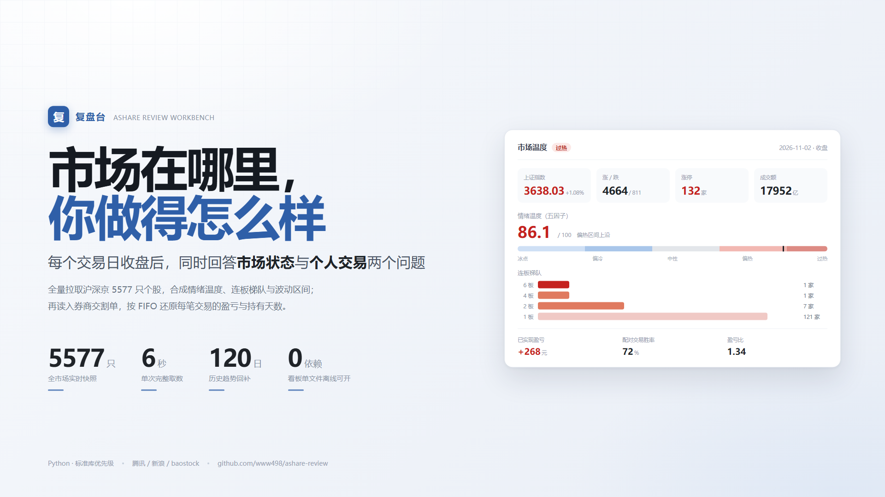
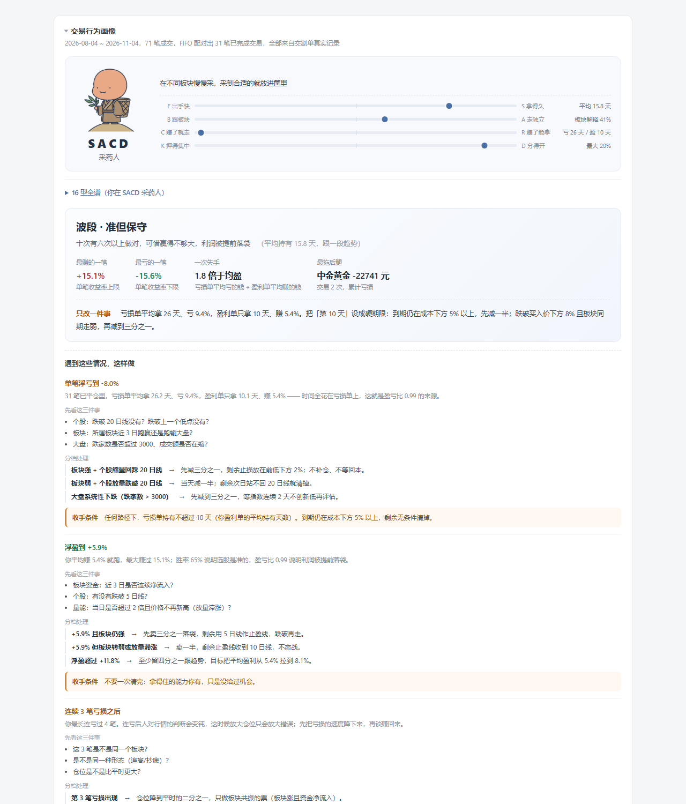
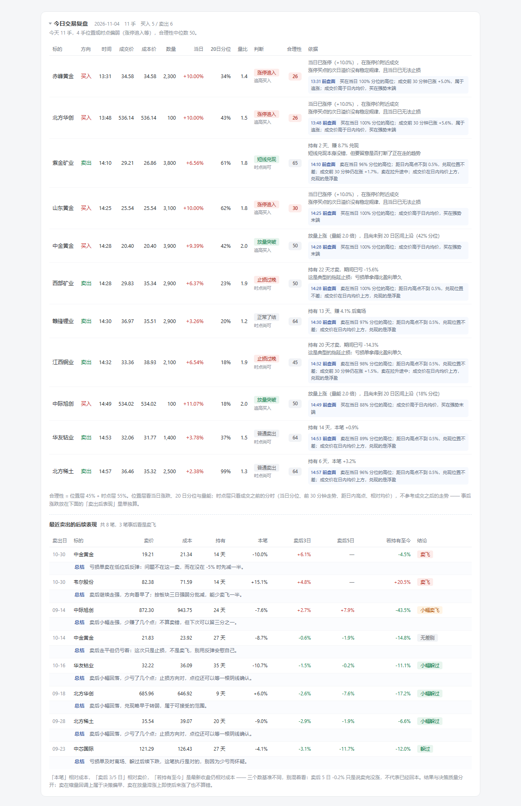

# 复盘台 · A 股市场与个人交易复盘



> 每个交易日收盘后，自动回答两个问题：**市场现在处在什么位置**，以及**你自己做得怎么样**。

行情软件只给你看市场。这个项目多做一件事：把你自己的交割单读进来，用 FIFO 配对还原每一笔交易的盈亏、持有天数、胜率与盈亏比，然后和当天的市场状态放在一起看。

沪深京全量 **5577 只**个股实时快照，取数约 6 秒。零第三方 UI 依赖，看板是单文件静态 HTML，离线可开。

---

## 界面

交易行为画像：16 型形象、四维坐标、16 型全谱，下面是「只改一件事」和分档应对手册。



今日逐笔复盘：11 手买卖，给成本价、成交时间、位置层与时点层的 0–100 合理性；
下方是最近卖出的后续表现，本笔、卖后 3/5 日、若持有至今三个基准分开列。



**在线演示**：<https://www498.gitee.io/ashare-review>（Gitee Pages 开启后可用；未开启时看上面的截图）
**本地打开**：下载仓库后双击 `docs/demo.html`，或解压 `dist/demo-offline.zip`，不需要联网。

---

## 为什么做这个

三个具体的痛点：

**1. 复盘报告大多是「今天涨停 68 家、成交 8000 亿」的罗列，看完不知道明天该干什么。**
所以午盘和收盘是两份不同的报告：午盘问「下午怎么走」，用的数据是上午收盘位置、炸板率、半日量能——这些收盘后就消失了；收盘问「明天怎么准备」，用的是连板梯队、进度率、温度分位、波动区间。

**2. 券商 App 告诉你赚了多少，但不告诉你为什么赚、赢在哪儿、亏在哪儿。**
交割单里每一笔买卖都有时间、价格、费用。按 FIFO 配对后能得到：这笔交易持有了几天、是盈是亏、盈亏比多少、胜率多高。如果「持有 3 天内的交易胜率 40%，持有 20 天以上的 75%」，这就是一条可以行动的信息。

**3. 大部分「AI 荐股」的数字是编的。**
这个项目里的每一个数字都能追溯到计算过程。大模型只负责把数字翻译成人话，输出后做数字溯源校验，落不到源数据的数字会被判为幻觉并重试或标红。

---

## 功能

### 市场侧

| 模块 | 内容 |
|---|---|
| 宽度 | 5577 只个股的涨跌分布、涨停跌停、涨幅分位、振幅结构 |
| 情绪温度 | 五因子自建指标（宽度 / 涨跌停结构 / 指数 / 量能 / 个股中位数），附 120 日趋势与历史分位 |
| 连板梯队 | 各板位家数、晋级率、昨日涨停股今日表现，全部离线计算 |
| 板块归因 | 个股 vs 所属行业中位数，判断「跟随板块」还是「个股独立事件」 |
| 波动区间 | HAR-RV 模型，未来 5 日 80% 区间；**并进每只自选股的展开区**，附滚动样本外覆盖率与 R²，不单独占一张卡 |
| 个股诊断 | 每只自选股的 20 日位置、均线结构、量能变化、需要盯的具体条件 |

### 个人侧

| 模块 | 内容 |
|---|---|
| 交割单还原持仓 | 从流水还原当前持仓与**含费移动加权成本**，用「股份余额」列交叉校验 |
| 人格速写 | 由胜率 × 盈亏比 × 持有天数组合出类型（如「短线 · 准但保守」），配 4 条硬事实与**一条最该改的事** |
| 16 型交易人格 | 四个维度各二选一（节奏 F/S、归因 B/A、盈亏 C/R、持仓 K/D），共 16 型、每型一个卡通形象与一句话特征；页内可展开全谱看自己在哪一格 |
| 应对手册 | 每条都是「触发条件 → 先看哪三件事 → 分档怎么减/怎么留 → 什么条件收手」，阈值从他的成交里推（如「浮亏到 -8%」来自他亏损单的中位幅度），不套通用参数 |
| 交易行为画像 | FIFO 配对：已实现盈亏、胜率、盈亏比、平均盈亏幅度、持有天数分布 |
| 持仓风险 | 仓位集中度、浮亏提示、单一标的占比过高的提醒 |
| 多日涨跌归因 | 每只自选股近 5 日涨跌拆成大盘 / 板块超额 / 个股超额，回答「为什么涨、为什么跌」 |
| 单日涨跌归因 | 今天这一下为什么：三段分解 + 量价形态 + 主力资金流 + 反常检测（板块普涨它独跌、放量跑输、利好不涨、高开低走），结论直接指向该查公告还是该认赔 |
| 个股主力资金流 | 东财大单拆分：主力净流入/流出、超大单、散户方向，用于识别「股价涨但主力在出」这类背离 |
| 个股消息面 | 当天与前一晚的公开快讯按「提到这只票 > 命中它所属行业 > 影响该行业的宏观事件」挂到**每只票的展开区**，不单独成块 |
| 个股后续关注 | 结合该股归因与相关快讯，给出未来几天要盯的具体事件或数据（LME 库存周报、议息点阵图这类可验证项） |

### 三个入口

**主页面 `/home`** 是登录后的落脚点，一屏内回答三件事：
我这个人做得怎么样（画像）、我每天的操作记录（按日期倒序，早盘/全天分开列）、
以及现在要不要跑一份新的（早盘复盘 / 全天复盘 / 即时复盘）。

**单日看板** 是按天切片的完整复盘，从主页的日期列表点进去。
看板顺序：持仓 → 今日交易复盘 → 自选股（含诊断、消息面、归因、波动区间）→ 市场区。
画像不重复放在单日看板里：它是「这个人」的底稿，常驻主页，不随日期变。
产品的主张是「先看你自己的钱和你这个人」，市场数据是背景板，所以个人区放在最前面。

**16 型图鉴 `persona.html`** 把 16 个形象按色系铺开，用来看自己站在哪一格。

### 交互

双击 `import_positions.bat` 启动本地工作台（`127.0.0.1:8765`），首次进入先注册/登录。
登录后落在主页：右上角是账号、导入交割单、三种复盘按钮；「持仓」和「自选股」
卡片标题右侧分别是导入与添加入口。

生成过程会逐步上报当前阶段（取数 → 行业归因 → 画像 → AI 解读 → 逐只波动率预测 → 看板），
界面上显示「已等 42s · 波动率预测 3/9 恒瑞医药」这样的进度，而不是一个转圈。
单只标的预测超过 28 秒、整体超过 150 秒会被跳过并记一行提示——宁可少算几只，也不让整份报告卡死。

没有独立的操作面板，也不再有悬浮按钮——**操作就贴在它作用的对象旁边**。
看板本身仍是零依赖静态页，直接双击打开时这些按钮不会出现（没有后端点了也没用）。

---

## 账号与多用户

工作台启动后先看到登录页。每个账号拥有独立的数据空间，互不可见：

```
users/<uid>/
  watchlist.txt     自选股
  positions.csv     持仓
  statement.xlsx    交割单
  reports/          该账号的看板与报告
  snapshots/        该账号的快照
```

行情类公共缓存（日K、成分股、行业分类、历史宽度）仍放在 `data/` 全局共享 ——
那是市场数据，与账号无关，按账号重复存储只会浪费几十 MB 并拖慢首次运行。

**安全口径（如实说明，不夸大）**

- 密码用 `hashlib.scrypt` 加盐哈希，不存明文也不存可逆形式
- 会话 token 为 32 字节密码学随机数，默认 7 天过期
- 服务只监听 `127.0.0.1`，Cookie 未设 `Secure`（本地无 HTTPS）
- **这不是面向公网的认证系统**，不要直接暴露到公网

**命令行仍支持单用户模式**：不传 `--user` 时读写项目根目录，老用法不受影响；
传 `--user <uid>` 则读写 `users/<uid>/`：

```bash
python run_review.py --session pm --user u_9f97fe4f8cf9
```

---

## 快速开始

```bash
pip install -r requirements.txt

# 收盘复盘（含波动率区间）
python run_review.py --session pm --forecast

# 午盘复盘（11:30–13:00 之间跑才有意义）
python run_review.py --session am

# 离线重放最近一次快照，不请求网络
python run_review.py --session pm --offline
```

跑完打开 `reports/index.html`，或起始服务后访问 `http://127.0.0.1:8765/` 落在主页。

**自检**：`python tests/run_checks.py`，离线校验归因可加性、FIFO 配对守恒、
16 型代号唯一性、新闻挂载边界。不联网，可直接接 CI。

**自动定时**：`python scheduler.py`，工作日 11:35 / 15:05 自动触发。交易日历内置 2025–2026 节假日，
非交易日不触发（避免把陈旧盘口写进历史表污染趋势）。

**Windows 双击入口**：`run_now.bat` 立即跑一次 / `start_scheduler.bat` 常驻调度 / `import_positions.bat` 工作台 / `open_dashboard.bat` 看板。

---

## 日常使用流程

**只需要记住一个入口：双击 `import_positions.bat`。**

1. 双击后浏览器打开 `http://127.0.0.1:8765`，先登录（第一次点「注册」建账号）
2. 登录成功落在**主页**：上面是交易行为画像，下面是每天两次复盘的列表
   （早盘 / 全天分开列，点日期进单日看板），右上角三个按钮用来跑新的复盘
3. 所有操作都在看板里，**操作贴在它作用的对象旁边**：

| 想做什么 | 在哪里 |
|---|---|
| 导入 / 更新持仓 | 「持仓」卡片标题右侧的**导入持仓** |
| 加自选股 | 「自选股」卡片标题右侧的**+ 添加** |
| 删自选股 | 自选股表格每行最右侧的 **×** |
| 用当前行情重跑 | 页头右上角的**生成即时复盘** |
| 看别的日期 | 页头右上角的**日期下拉框** |
| 退出登录 | 页头右上角的**退出** |

4. 那个黑色命令行窗口要一直开着，关掉服务就停了

**另外两个入口**（可选，都会读根目录的 `launch_user.txt` 确定账号）：

- `run_now.bat`：立即重跑一次并打开报告
- `start_scheduler.bat`：常驻，交易日 11:35 / 15:05 自动跑

`launch_user.txt` 只有一行账号 uid（在 `users/_accounts.json` 里查）。
不建这个文件时，这两个脚本走单用户模式，结果写进项目根目录 `reports/`，登录后看不到。

---

## 演示账号

评委需要看到「成交密集」的样本才有说服力，真实账号一天也就两三笔。仓库自带一个生成器：

```bash
python -m ashare.demo      # 用真实日K价格构造 60 笔成交，其中当天 14 笔
```

它生成 `data/demo_statement.csv`，再在工作台里导入即可（或直接放到
`users/demo/statement.csv`）。演示账号 `demo / demo123456` 已按此方式建好。

构造时刻意守了三条约束，否则数据一眼假：

1. **T+1 成立**：今天买的不能今天卖，卖出的都是更早的底仓。
2. **同一只票清仓后才允许再买**，否则 FIFO 会把卖出配到更早的批次，
   画像统计全错（这一条踩过坑，第一版胜率从设计的 70% 变成 45%）。
3. 价格全部取自真实收盘价，只加千分之一量级滑点；日期都是真实交易日。

交易风格是设计的：选股偏准（胜率约 65%），但盈利单拿 10 天、亏损单拖 26 天
—— 这样画像会指向「赚了就走、亏了死扛」（盈亏维 C）这个真实弱点，应对手册才有内容可写。

---

## 大模型（可选）

配置后自动启用，不配也能跑（规则文案兜底，功能不缺失）：

配置文件是项目根目录的 `llm_key.txt`（已 gitignore），换服务商只改这三行：

```
key=sk-xxxxxxxx
base_url=https://api.uniportai.com/v1
model=deepseek-v4.1-flash-1017
```

只写一行裸 key 也认，此时用 DeepSeek 官方地址与默认模型。
环境变量 `LLM_API_KEY` / `LLM_BASE_URL` / `LLM_MODEL` 优先级更高。

中转站经常出现「模型列表里有、实际返回 404/405」的情况，
代码会按 `deepseek-v4.1-flash-1017 → deepseek-v4.1-flash → deepseek-v4-flash → deepseek-chat` 自动回退，
并在日志里打印「配置的是 A，实际用了 B」，避免你以为在跑 A 其实跑的是 B。

它做两件事：市场解读、个人点评（画像自然语言 + 每只自选股的归因短评）。
**所有数字由代码算好注入，模型只负责组织语言**；输出后做数字溯源校验，
带单位的数字必须能在输入数据里找到，否则打回重写，两次不过就降级为规则文案。

`llm_key.txt` 已在 `.gitignore` 里，不会进仓库。

---

## 数据接入

### 自选股

`watchlist.txt`，格式不限，只在该文件里放「额外关注」的标的：

```
600519                      纯代码
600519,贵州茅台              代码 + 名称
600519,贵州茅台,100,1392.05  带持仓（不填则由交割单还原）
```

### 持仓与交割单

券商客户端里的本地持仓库是私有加密格式、需要登录态，不读也不该读。走官方出口：

- **交割单 / 对账单**（推荐）：含每笔成交，能还原持仓、算含费成本、做行为画像。
  如果导出里有「成交时间」列，逐笔复盘会据此判断成交时点；
  没有这一列则退回日线判断，不会硬猜时间。
- **持仓表**：直接给「代码 / 名称 / 数量 / 成本价」，列名自动识别，顺序随意

把文件命名为 `statement.xlsx` 或 `positions.csv` 放在根目录，或在工作台里直接粘贴/上传。
支持 CSV / TXT / xlsx，表头关键词自动映射。

```bash
python -m ashare.positions --check    # 看列识别与还原结果
```

> 个人数据（`positions.csv`、`statement.xlsx`、`watchlist.txt`）已在 `.gitignore` 中排除，不会进入仓库。

---

## 设计取舍

### 为什么不做涨跌方向预测

测过，不行。这不是保守，是实证结论：

| 实验 | 结果 |
|---|---|
| 个股 5 日方向（LR / GBDT，walk-forward，814 样本） | 准确率 53.8%，「永远猜跌」基线 53.0%；Brier 0.256 差于基线 0.248；校准曲线反向 |
| 条件概率分箱（动量 / 均线偏离五分档） | 各档上涨概率全在 46–53%，样本外多档翻转 |
| **波动率预测（HAR-RV + log + 500 日滚动重训）** | **样本外 R² 0.07–0.13，可用** |

所以产品给的是**波动包络**而不是点位预测。区间覆盖率是滚动样本外实测值（79–84%，目标 80%），
不是拿全样本分位自证出来的 80%。

R² 对样本长度极敏感：800 条为负、1600 条 0.01–0.16、2800 条才稳定在 0.07–0.13，因此模型默认取 11 年样本。
报告里如实标注个别标的为负（该股波动率不可预测），不粉饰。

### 大模型为什么只解释、不计算

所有数字由代码算完再注入 prompt，模型不允许生成任何数值。输出后做数字溯源校验：
带单位的数字（%/亿/元/pp）必须能在源数据中匹配，否则判为幻觉，带违规清单重试，仍不通过就标红展示。

校验器实测强度（2026-11-02 收盘快照、96 个唯一事实值，各压测 300 条）：

| 类型 | 拦截率 |
|---|---|
| 随机编造的「X 亿」 | 95.7% |
| 随机编造的「X%」 | 93.3% |

容差为「相对 0.2% 与绝对 0.02 取大」。早期版本用 2% 相对容差，17952 亿的窗口宽达 ±359 亿，拦截率只有 88%。
这是个概率性防线，不是确定性证明，所以把实测数字写在这里，而不是只说「会校验」。

---

## 目录结构

```
run_review.py        主入口：取数 → 分析 → 报告 → 看板 → 快照
scheduler.py         常驻调度器（11:35 / 15:05，带交易日历判断）
import_positions.bat 工作台入口（本地服务 8765）
watchlist.example.txt  自选股模板

ashare/
  config.py     指数清单、阈值、温度分档、市场范围
  tcal.py       交易日历（本地历史表优先 + 内置节假日）
  data.py       腾讯批量行情、成分股、指数日K
  analyze.py    宽度、量能折算、温度打分、异动、时段视图
  industry.py   行业映射（baostock）+ 板块联动归因
  ladder.py     连板梯队与晋级率（离线算，零请求）
  forecast.py   HAR-RV 波动率预测 + 80% 区间 + 滚动覆盖率
  history.py    120 日宽度回补 + 趋势摘要
  detail.py     个股分时 / 近20日 / 昨日对比
  stockcard.py  个股诊断
  watchlist.py  自选股解析与合并
  positions.py  持仓表/交割单识别、列名映射、盈亏核算
  statement.py  交割单还原持仓（含费移动加权 + 余额交叉校验）
  profile.py    交易行为画像（FIFO 配对、胜率、盈亏比、持有天数）
  journal.py    当日逐笔复盘：位置层 + 成交时点层，给 0-100 合理性；卖出后 3/5 日回看
  intraday.py   分时抓取与成交时点评分：只用成交前的分时，不用之后走势
  mover.py      多日涨跌归因（大盘 / 板块超额 / 个股超额）
  explain.py    单日涨跌归因：三段分解 + 量价形态 + 反常检测
  fundflow.py   个股主力资金流（东财，大单拆分）
  news.py       财经快讯抓取、按个股/行业/宏观事件挂载
  persona_art.py  16 型人格形象（AI 图 + SVG 兜底）
  gallery.py    16 型人格图鉴页
  home.py       主页面：画像 + 每日复盘列表 + 生成入口
  report.py     Markdown 渲染
  web.py        静态看板渲染
  timeline.py   历史趋势页（含多日对比）
  site.py       首页索引
  panel.py      注入式操作面板（CSS + HTML）
  panel_js.py   面板交互脚本
  importer.py   本地工作台服务（标准库 http.server）
  auth.py       账号体系（scrypt 哈希、会话、按账号隔离目录）
  authpage.py   登录/注册页
  context.py    当前账号上下文，集中解析各模块的读写路径
  llm.py / attrib.py  LLM 解释层（含数字溯源校验，可选）

tools/
  persona_alpha.py    人格形象抠图与尺寸归一
  make_art.py         生成 docs/ 下的封面与海报
  make_intro.py       25 秒片头逐帧绘制（红绿数字 → 问号 → 定格）
  make_video.py       100 秒正片：真实界面截图 + 缓慢推近 + 字幕 + 收尾卡
  make_final_video.py 无损拼接片头与正片 → docs/demo.mp4
  inject_demo_profile.py 给在线体验页幂等注入「人物性格画像」区块
  fill_trade_time.py  用当日分时给没有时间列的交割单反推成交时间（价格须对得上）
  rerender_demo.py    按历史快照重渲染某天的看板，不重新联网取行情
  refresh_profile.py  按最新口径重算快照里的画像（建议文案、四维标签）
  fill_forecast.py    给自选股补齐未来 5 日波动区间（HAR-RV 较重，单独跑）
  build_demo_page.py  把某天看板导出成 docs/demo.html 并注入画像
  gh_push.py          走 GitHub API 推送（本机 git 协议常被代理拦）

tests/
  run_checks.py     离线自检：口径一致性、FIFO 配对、归因可加性

research/
  exp_signal.py    方向预测实验（结论：不可用）
  exp_predict.py   波动率预测实验
  probe_akshare.py 数据源可用性探测
  probe_backup.py  备用数据源探测

data/          行情公共缓存，所有账号共享（不入库）
users/<uid>/   各账号的自选股、持仓、交割单、报告（不入库）
docs/          封面、海报、演示片、在线体验页（demo.html）、16 型形象（assets/persona/）、提报材料
reports/       单用户模式下的报告输出（不入库）
```

---

## 演示视频

成片 `docs/demo.mp4`：1280×720 / 30fps / **125 秒** / 无声（信息全在字幕里，静音也能看）。

| 时间 | 画面 | 想说的一件事 |
|---|---|---|
| 0:00–0:12 | 沪深京口径的红绿数字高速冲刷，底部压「涨了多少家、成交多少亿」 | 收盘后你看到的只有市场 |
| 0:12–0:25 | 急停、问号淡入，文案上移定格「这些数字，和你的账户有什么关系？」 | 把问题从市场转到自己 |
| 0:25–0:30 | 开场字卡「不复盘，就只是重复」 | 立题 |
| 0:30–0:41 | 主页：画像常驻，下面按日期排着每天的复盘 | 先看到「这个人」 |
| 0:41–0:50 | 画像上半：SACD 采药人卡通形象、四维坐标、16 型全谱高亮 | 类型是坐标，不是标签 |
| 0:50–0:57 | 画像下半：人格速写、只改一件事、AI 建议、应对手册 | 给画像就要给改法 |
| 0:57–1:04 | 16 型形象图鉴：8 个 AI 卡通形象同屏 | 16 型各有各的打法 |
| 1:04–1:15 | 单日看板：市场温度、持仓、今天做的每一笔 | 回到市场 |
| 1:15–1:28 | 今天为什么涨：大盘 + 板块 + 个股，三段可直接相加 | 答案落到每一只票 |
| 1:28–1:40 | 涨了 3.6% 却跑输 6.1% 的板块，量还放大了 —— 借势出货 | 反常也要解释 |
| 1:40–1:52 | 今天 11 手逐笔复盘：该不该买/卖，只用成交当时的数据 | 落到每一笔操作 |
| 1:52–2:01 | 卖出后 3/5 日回看：卖飞还是躲过，结果与决策质量分开算 | 复盘不是事后诸葛亮 |
| 2:01–2:05 | 收尾卡「每一笔，都算得清」+ 产品全名 | 和开头呼应 |

画像镜头放在主页之后、单日看板之前：产品是「市场复盘 × 这个人」两半，
先给类型、再给改法，后面才谈当天行情。结尾删掉了「5577 只 · 6 秒」这类指标字卡，
最后两个镜头全部留给逐笔复盘与卖出回看，收尾卡也只讲内容、不堆指标。

片头用逐帧绘制而不是风格化视频生成：画面里的涨跌幅、涨跌家数、成交额都要能和
真实行情对上，生成式画面写不准数字，节奏也没法卡在 12 秒那一下急停。

三段各自可复现，改一句文案只需重渲染对应那一段（需要 `Pillow` + `imageio-ffmpeg`）：

```bash
python tools/make_intro.py        # docs/intro.mp4，25 秒
python tools/make_video.py        # docs/demo_body.mp4，100 秒（用已入库的 vid_*.png 界面截图）
python tools/make_final_video.py  # docs/demo.mp4，125 秒，流拷贝无损拼接
```

`docs/intro.mp4`、`docs/demo.mp4` 和 7 张 `vid_*.png` 界面截图都入库
（本地快照涉及个人数据不入库，所以截图作为素材随仓库走，clone 下来就能重出视频）；
`demo_body.mp4` 是中间产物，不入库。
拼接用 concat + `-c copy`，脚本会核对「25 + 100 = 125 秒、误差 0」才算成功。

---

## 在线体验页

`docs/demo.html` 是演示账号的静态看板，随仓库部署到 GitHub Pages：
<https://www498.github.io/ashare-review/demo.html>。除市场概况外，
页面顶部还有两块和「人」有关的内容，和主页保持一致：

| 区块 | 内容 |
|---|---|
| 交易行为画像 | 当前型卡通形象、四维坐标、16 型全谱高亮、人格速写、只改一件事、AI 建议、应对手册 |
| 16 型形象图鉴 | 16 张 AI 卡通形象，8 × 2 排布，当前型蓝色高亮 |

画像数据取自 `docs/profile_demo.json`（演示账号快照里的 `profile` 字段），
图鉴图片在 `docs/assets/persona/`。重新导出看板后跑一次
`python tools/inject_demo_profile.py` 就能把这两块加回来：脚本用标记包裹、幂等替换，
重复运行不会重复插入。当前型图片由 `persona_art.badge()` 以 base64 内嵌，
零外部依赖；只有图鉴用相对路径图片，Pages 与本地 `file://` 都能打开。

页首还加了一层「答辩视图」：价值主张 + 四个数字 + 章节导航（概览 / 画像 / 持仓 / 逐笔 / 自选股 / 市场），
以及窄屏横向滚动与投屏打印样式。这层只作用于 `docs/demo.html`，不改变产品看板本身。

---

## 国内托管与答辩兜底

GitHub Pages 在国内的访问不稳定，所以演示准备了两条路：

| 用途 | 位置 | 说明 |
|---|---|---|
| 现场演示（首选） | `dist/demo-offline.zip` → 解压双击 `demo.html` | 不联网、不启动服务，约 1.5MB |
| 代码备份 / 评委访问 | Gitee 或 GitCode | `tools/cn_push.py` 一键推送全部分支与标签 |

`docs/DEPLOY_CN.md` 写了完整步骤：网页导入、令牌推送、Gitee Pages 开启、当天检查清单。
推送令牌只走命令行，推完会从 `.git/config` 里抹掉，不写进仓库。

答辩材料在 `ppt/复盘台答辩/`：10 页、7 分钟，设计稿见同目录 `DESIGN.md`，
逐页时间分配见该文件末尾。

---

## 数据来源

| 用途 | 来源 | 说明 |
|---|---|---|
| 全市场实时行情 | 腾讯 `qt.gtimg.cn` | 60 只/批并发，5577 只约 6 秒 |
| 历史日K回补 | 新浪 | 不触发腾讯反爬（连续全量拉取会被 501 拦截十分钟以上） |
| 前复权日K（模型） | baostock | 除权跳空已抹平，不污染波动率 |
| 行业分类 | baostock | 证监会分类 79 类，缓存 30 天 |
| 盘中分时 | 腾讯 | 267 点/日，采样后约 55 点 |
| 北交所成分 | 新浪 `hs_bjs` 节点 | akshare 的北交所接口走 bse.cn，常被拦截 |
| 板块资金流 | 东财 | 可选；被限流时自动退回自有行业口径 |
| 个股主力资金流 | 东财 `push2` | 按单笔金额拆超大单/大单/中小单；9 只并发约 1.2 秒 |
| 财经快讯 | 华尔街见闻 + 新浪财经 | 只取标题（见「口径说明」），当天缓存，跨夜取 80 条 |

---

## 口径说明

- **市场范围**：沪深京 5577 只，代码前缀自动判定（6 沪 / 0、3 深 / 92、43、83、87 京）
- **涨停**：现价达到当日涨停价（主板 10%、创业板/科创板 20%、北交所 30%）
- **量能**：按行情时点折算已走完全天的比例（上午记 53%，下午按分钟补齐），再与昨日全日成交量对比
- **上午收盘位置**：`(现价 − 最低) / (最高 − 最低)`，衡量最后一小时动能，收盘后语义变为全天
- **炸板率**：摸过涨停但没封住 / 摸过涨停总数，短线情绪转弱的领先信号
- **已实现盈亏**：FIFO 配对，含双边手续费，与券商「摊薄成本」口径一致
- **温度**是自建相对指标，只在纵向比较时才有意义，跨口径不可比

---

## 已知限制

- **午盘快照不可回溯**：11:30 的盘口只在当时存在，非 11:30 运行会带明确警告
- **连板依赖日K缓存**：缓存最后日期不是今日或上一交易日时，报告会提示运行 `python -m ashare.history`
- **交易日历需每年维护**：`ashare/tcal.py` 的 `HOLIDAYS` 目前覆盖 2025–2026，未覆盖年份退化为仅排除周末
- **行业分类较粗**：证监会 79 类（如「电子设备」含 266 只），板块联动判断够用，细分不够
- **北交所无行业分类**：baostock 行业表只覆盖沪深，北交所个股显示「未分类」
- **交割单不含分红送转**：期间若送股，数量以「股份余额」列为准并给出提示
- 本项目为历史与实时数据的统计描述工具，**不构成投资建议**

---

## License

MIT
